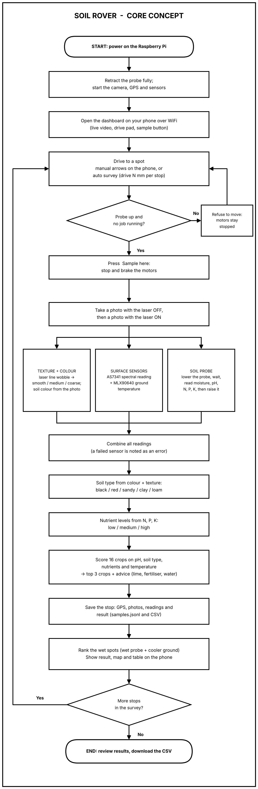
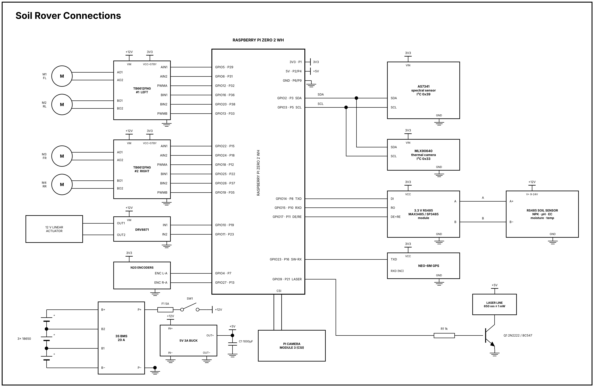
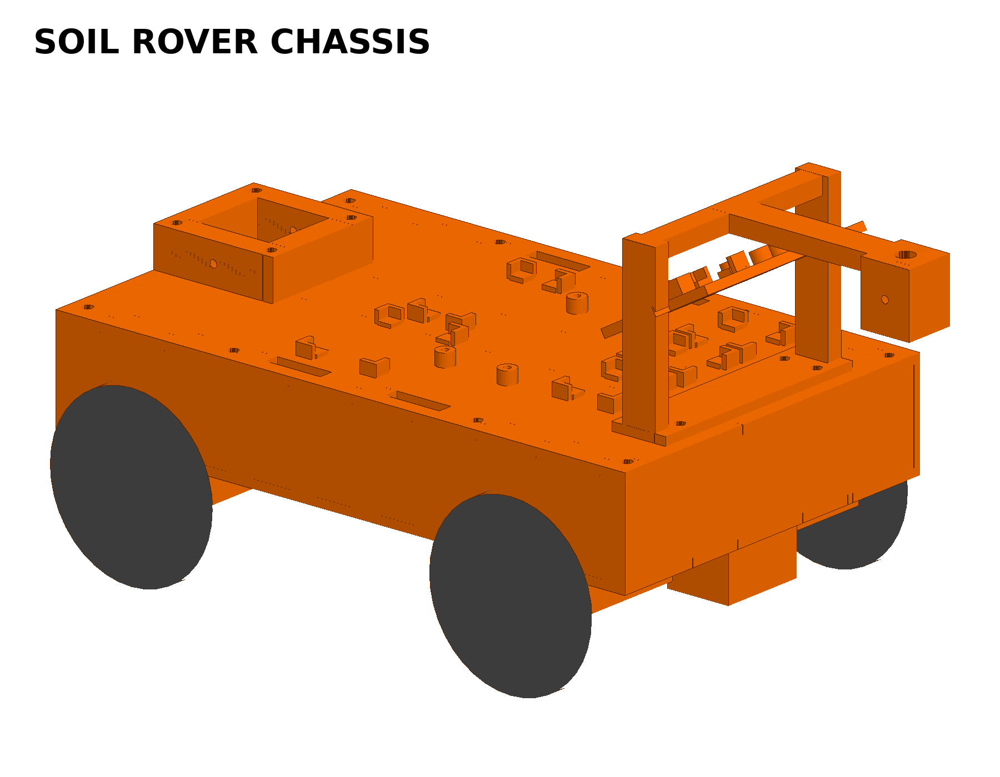

# Soil rover software

An Rover for Soil. It uses Laser and camera to detect soil type and structure and suggest crops according to it.It also has a thermal camera used to find the place with more water. so that user can use that spot as water source.

I hope this rover help many poor farmers without knowing soil type and place with more water. This is powered by Raspberry Pi as micro controller and transmitts data through Wifi to users mobile phone.

## Connections
| Function | Pins |
|---|---|
| Left TB6612 (FL, RL) | IN 5/6 + PWM 12, IN 16/20 + PWM 13 |
| Right TB6612 (FR, RR) | IN 22/24 + PWM 18, IN 25/26 + PWM 19 |
| Probe actuator (DRV8871) | IN1 10, IN2 11 |
| Laser (via transistor) | 9 |
| Encoders A-channel | left 4, right 27 |
| RS485 soil sensor | UART 14/15, DE+RE 17 |
| GPS NEO-6M TX | 23 (bit-bang serial) |
| AS7341, MLX90640 | I2C 2/3 |

## Chassis

## How it decides
* **Texture:** laser-on minus laser-off picture finds the line; how much it wobbles (mm) gives smooth / medium / coarse.
* **Colour:** dark = black soil, red-brown = red soil, light and coarse = sandy, dark and smooth = clay, otherwise loam.
* **Crops:** each crop is scored on pH fit, soil fit, nutrient levels and soil temperature.
* **Water spots:** By Using Thermal Camera and ranked by probe moisture, plus a bonus for ground cooler than the average of your samples.

## Parts Used

* Pi Zero 2 WH
* 32GB microSD
* Pi Zero camera cable
* 5V 3A buck converter
* 3× 18650 cells
* 3S 20A BMS + holders
* 3S charger
* 4× N20 12V motors with encoders
* Wheels and mounts
* 2× TB6612FNG drivers
* Pi Camera Module 3
* Laser line module (1 mW, Class2)
* AS7341 spectral sensor
* RS485 soil sensor (NPK, pH, EC, moisture)
* MAX485 module
* Mini linear actuator + driver
* MLX90640 thermal camera
* NEO-6M GPS

## Safety and limits
* The drive refuses to move while a job runs or the probe is not fully up.
* Motors stop if the phone stops sending commands for 0.6 s.
* The Values taken are just test values not real ones 

